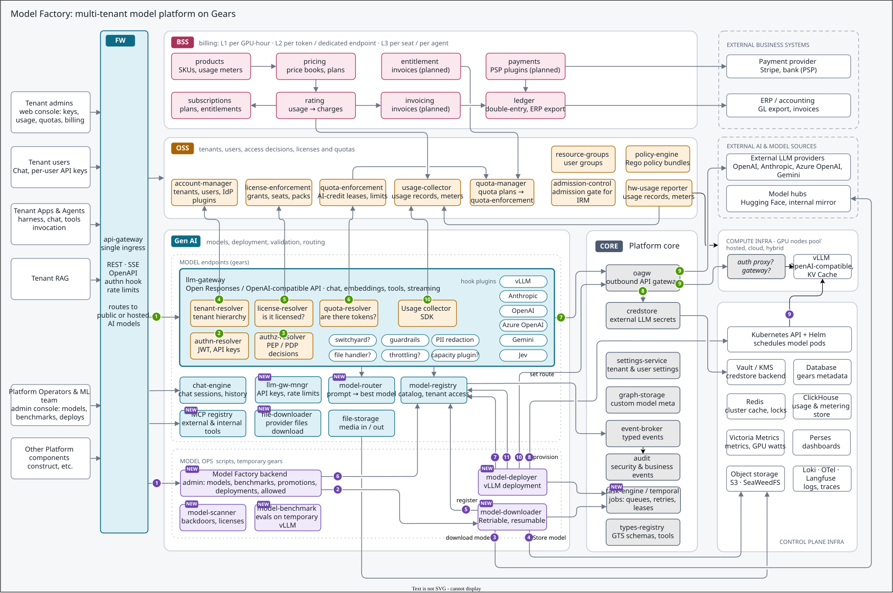

# DECOMPOSITION

Components are taken from the [Model Factory architecture](img/model-factory.drawio.svg). Each owner is the top non-bot committer to the matching `gears/` folder in `gears-rust`. `TBD (new)` means the component has no gear yet.

Priorities: `p1` - needed for the first release (manage models, serve the inference API); `p2` - needed for production at scale; `p3` - later.

# FW

## Nginx

- Owner: A.Plakunov (Envoy gateway API)

- [ ] `p1` - #{ID} - Expose the OpenAI-compatible inference routes (`/v1/responses`, `/v1/chat/completions`, `/v1/embeddings`, `/v1/models`) on the single ingress and route them to model-gateway.
- [ ] `p1` - #{ID} - Pass SSE streams from model-gateway to the client without buffering, with keep-alive pings and correct handling of client disconnects.
- [ ] `p1` - #{ID} - Allow large request bodies on inference routes (long prompts, base64 images) with a configurable size limit per route.

# BSS

## products

- Owner: Diffora (`gears/bss/products`)

- [ ] `p3` - #{ID} - Define Model Factory product SKUs: L1 per GPU-hour, L2 per token (input, output, cached), dedicated endpoint, L3 per seat / per agent.
- [ ] `p3` - #{ID} - Define usage meters for model usage (input tokens, output tokens, cached tokens, embeddings tokens, GPU-hours, images) and link each meter to a SKU.
- [ ] `p4` - #{ID} - Link a product to one or more models from model-registry, so a model can be sold only when it is part of an active product.

## pricing

- Owner: Diffora (`gears/bss/pricing`)

- [ ] `p3` - #{ID} - Support per-model price books: a price per 1M input / output / cached tokens and per GPU-hour, set per tenant plan.
- [ ] `p3` - #{ID} - Publish the per-model price in AI credits so model-gateway plugins can compute the cost of a call from model settings.
- [ ] `p4` - #{ID} - Support tiered and volume prices (for example a lower token price after 100M tokens per month).

## quota-manager

### Quota management in Model Factory Backend

- Owner: TBD (new)

- [ ] `p1` - #{ID} - Simple/temporary implementation in Model Factory backend and pushing them to quota-enforcement.

### Standalone Quota management gear

- Owner: TBD (new)

- [ ] `p3` - #{ID} - Create the quota-manager gear that turns plans and entitlements into quota plans (AI-credit limits, token limits, rate limits per tenant and per user) and pushes them to quota-enforcement.
- [ ] `p3` - #{ID} - Let tenant admins split the tenant AI-credit budget between child tenants, users and API keys.
- [ ] `p4` - #{ID} - Support time windows for quotas (per day, per month) with automatic reset.
- [ ] `p4` - #{ID} - Send notifications when a tenant or user reaches 80% and 100% of a quota.

## payments

- Owner: TBD (new)

- [ ] `p4` - #{ID} - Create the payments gear with a PSP plugin interface and a Stripe plugin to charge cards and handle payment webhooks.
- [ ] `p4` - #{ID} - Support prepaid AI-credit top-ups: a tenant pays, and the credits are added to the tenant balance in ledger.
- [ ] `p5` - #{ID} - Add a bank transfer PSP plugin for enterprise invoices.

## subscriptions

- Owner: Diffora (`gears/bss/subscriptions`)

- [ ] `p3` - #{ID} - Implement the subscriptions gear (docs exist, no code yet): create, change and cancel a tenant subscription to a plan.
- [ ] `p3` - #{ID} - Grant entitlements from an active subscription (allowed models, seats, AI-credit packs) and remove them when the subscription ends.
- [ ] `p4` - #{ID} - Support trial subscriptions with a fixed AI-credit grant and an end date.

## rating

- Owner: capybutler (`gears/bss/rating`)

- [ ] `p3` - #{ID} - Implement the rating gear (docs exist, no code yet): read usage records from usage-collector and turn them into charges with the price book of the tenant.
- [ ] `p3` - #{ID} - Rate model usage per model, per tenant and per API key, so the cost is visible at each level.
- [ ] `p4` - #{ID} - Re-rate usage for a past period when a price was corrected.

## invoicing

- Owner: TBD (new)

- [ ] `p4` - #{ID} - Create the invoicing gear that builds a monthly invoice per tenant from rated charges, with one line per model and SKU.
- [ ] `p4` - #{ID} - Export invoices and GL entries to the ERP / accounting system.

## ledger

- Owner: Diffora (`gears/bss/ledger`)

- [ ] `p3` - #{ID} - Keep a per-tenant AI-credit balance account: add credits on purchase or grant, and subtract credits on rated usage.
- [ ] `p4` - #{ID} - Provide a per-tenant statement of credit movements (grants, top-ups, usage, refunds) for the web console.

# OSS

## account-manager

- Owner: Diffora (`gears/system/account-management`)

<!-- need to decide how API keys should be managed in OSS
- [ ] `p1` - #{ID} - Let users create, list, rotate and revoke personal API keys for the inference API, with an optional expiry date and allowed models.
- [ ] `p1` - #{ID} - Let tenant admins create service API keys for tenant apps and agents, not bound to a user.
- [ ] `p2` - #{ID} - Show the last-used time and usage of each API key in the web console.
-->

## license-enforcement

- Owner: Alex T (`gears/system/license-enforcement`)

- [ ] `p1` - #{ID} - Implement the license-enforcement gear (docs exist, no code yet): check that a tenant has a valid grant before a model call.
- [ ] `p1` - #{ID} - Support seat grants for chat users and per-model grants for premium models.

## quota-enforcement

- Owner: Vladan Gojgic (`gears/system/quota-enforcement`)

- [ ] `p1` - #{ID} - Add AI-credit quota types for model usage: reserve an estimated cost before the call and commit the real cost after the call.
- [ ] `p1` - #{ID} - Add token quota types (input + output tokens per period) per tenant, user and API key.
- [ ] `p3` - #{ID} - Add concurrent-request limits per tenant for expensive models (for example max 5 parallel requests to a 70B model).

## usage-collector

- Owner: capybutler (`gears/system/usage-collector`)

- [ ] `p1` - #{ID} - Add usage record types for model calls: tenant, user, API key, model id, input / output / cached tokens, cost in AI credits, capabilities (reasoning effort, fast/normal), status.
- [ ] `p1` - #{ID} - Add usage records for GPU time of deployed models (GPU type, count, hours) per tenant and deployment.
- [ ] `p2` - #{ID} - Provide a usage query API grouped by model, tenant, user, API key and day, for the web and admin consoles.

## hw-usage-collector

- Owner: TBD (`TBD`)

<!--
Need to check with VZ team
-->

## policy-engine

- Owner: Fluid (`gears/system/policy-engine`)

<!--
Need to check with Virtuozzo team. Do we need it all in p1?

- [ ] `p1` - #{ID} - Add Rego policies for model access: which tenants, roles and API keys may call which models.
- [ ] `p1` - #{ID} - Add Rego policies for Model Ops actions: who may register, scan, benchmark, approve, deploy and undeploy models.
- [ ] `p2` - #{ID} - Add data-residency policies: allow a model only when its hosting region matches the tenant region.
-->

## admission-control

- Owner: Fluid (`gears/system/admission-control`)

<!--
Need to check with Virtuozzo team. Do we need it all in p1?

- [ ] `p1` - #{ID} - Check model deployments before IRM provisions them: the GPU type and count are allowed for the tenant and there is enough GPU capacity.
- [ ] `p2` - #{ID} - Reject deployments of models that have not passed model-scanner or are not approved in model-registry.
-->

# GenAI - Model endpoints

## llm-gateway

- Owner: pr0tey (`gears/llm-gateway`)

- [ ] `p1` - #{ID} - Implement Open Responses API, normalize errors and completion statuses
- [ ] `p1` - #{ID} - Add pass-through APIs for OpenAI and Anthropic APIs.
- [ ] `p1` - #{ID} - Resolve each request through model-registry (or model-router), fetch the provider key from credstore, and call the provider plugin through oagw.
- [ ] `p1` - #{ID} - Run the request pipeline hooks in a fixed order: authn, tenant, authz, license, quota reserve, guardrails, provider call, quota commit, usage record.
- [ ] `p1` - #{ID} - Implement the embeddings API for all plugins that support it.
- [ ] `p1` - #{ID} - Add retries for provider calls that fail with transient errors.
- [ ] `p1` - #{ID} - Emit prometheus metrics per model (requests, errors, latency, time to first token, tokens per second).
- [ ] `p2` - #{ID} - Add fallback/switch/balancing to the next model from model-router when the provider returns a retriable error (timeouts, 429, 5xx) before any output was streamed.
- [ ] `p2` - #{ID} - Support async jobs and batch requests with results stored in file-storage.
- [ ] `p3` - #{ID} - Support image generation, text-to-speech and speech-to-text APIs.

Plugin:

- [ ] `p1` - #{ID} - vLLM plugin, Owner: TBD (new)
- [ ] `p1` - #{ID} - OpenAI plugin, Owner: TBD (new)
- [ ] `p1` - #{ID} - Anthropic plugin, Owner: TBD (new)
- [ ] `p2` - #{ID} - Azure OpenAI plugin, Owner: TBD (new)
- [ ] `p2` - #{ID} - Gemini plugin, Owner: TBD (new)
- [ ] `p2` - #{ID} - Jev plugin, Owner: TBD (new)

## llm-gw-mngr

- Owner: TBD (new)

- [ ] `p1` - #{ID} - Manage LLM gateway API

## tenant-resolver

- Owner: Artifizer (`gears/system/tenant-resolver`)

- [ ] `p1` - #{ID} - Resolve the tenant and its ancestors from an API key in under a few milliseconds (cached), so model-gateway and model-registry can build the effective model catalog per request.

## license-resolver

- Owner: Alex T (`gears/system/license-resolver`)

- [ ] `p1` - #{ID} - Answer "is this tenant / user licensed to call this model?" with a cached, low-latency call from the model-gateway pipeline.

## quota-resolver

- Owner: TBD (new)

- [ ] `p1` - #{ID} - Create the quota-resolver hook for model-gateway: reserve the estimated AI-credit cost before the call, commit the real cost after it, and release the reservation on error or client disconnect.
- [ ] `p1` - #{ID} - Return a clear `quota_exceeded` error with the quota name and reset time when a request is over the limit.

## usage-collector SDK

- Owner: CommName (`gears/system/usage-collector`)

- [ ] `p1` - #{ID} - Add an SDK helper for model-gateway that sends one usage record per model call with at-least-once delivery, also for streams that end early.

## authn-resolver

- Owner: Artifizer (`gears/system/authn-resolver`)

- [ ] `p1` - #{ID} - Validate inference API keys (hashed lookup, expiry, revocation) and return the user, tenant and key scopes (allowed models).

## authz-resolver

- Owner: MikeFalcon77 / Artifizer (`gears/system/authz-resolver`)

- [ ] `p1` - #{ID} - Add the `model:evaluate` permission check per model and the model-registry / Model Ops management permissions to the PEP / PDP flow.

## guardrails

- Owner: TBD (new)

- [ ] `p2` - #{ID} - Create the guardrails hook for model-gateway that checks input and output with configurable rules (blocked words, prompt-injection check, moderation model) and blocks or flags the request.
- [ ] `p2` - #{ID} - Let tenant admins enable guardrail rules per tenant and per model.

## PII redaction

- Owner: TBD (new)

- [ ] `p2` - #{ID} - Create the PII redaction hook that finds personal data (emails, phones, card numbers, names) in prompts and masks it before the provider call, with an option to restore it in the response.
- [ ] `p2` - #{ID} - Let tenant admins turn PII redaction on per tenant and per provider (for example only for external providers).

## chat-engine

- Owner: Dmitry Matveev (`gears/chat-engine`)

- [ ] `p1` - #{ID} - Call models only through model-gateway and list models through model-registry, so chat uses the same access, quota and usage rules as the API.
- [ ] `p2` - #{ID} - Let users pick a model, or "auto", per chat session; "auto" uses model-router.

## file-downloader

- Owner: TBD (new)

- [ ] `p2` - #{ID} - Create the file-downloader gear that downloads provider files (generated images, batch results) and stores them in file-storage, linked to the request.

## model-router

- Owner: TBD (new)

- [ ] `p1` - #{ID} - Create the model-router gear with model aliases (for example `glm-latest` -> `vllm::glm-4.6`), so clients keep working when a model is upgraded or removed.
- [ ] `p1` - #{ID} - Support a fallback list per alias: when the first model is disabled, unhealthy or over quota, route to the next one.
- [ ] `p2` - #{ID} - Route by request features: pick a model that supports the needed capabilities (tools, vision, context size) and is cheapest.
- [ ] `p2` - #{ID} - Support weighted routing between deployments of the same model (canary, A/B test).
- [ ] `p3` - #{ID} - Route by prompt ("prompt -> best model") using a small classifier model.

## model-registry

- Owner: Qilin101 (`gears/model-registry`)

- [ ] `p1` - #{ID} - Implement the model-registry service (only the SDK exists today): provider and model CRUD, sharing, shadowing, approval, effective catalog and resolve API, as defined in the model-registry PRD.
- [ ] `p1` - #{ID} - Register self-hosted models with a link to their deployment: when model-deployer creates or removes an endpoint, the model `base_url` and status are updated.
- [ ] `p1` - #{ID} - Store model lifecycle status (registered, downloading, scanning, benchmarking, ready, deployed, deprecated, retired) and show it in the admin console.
- [ ] `p1` - #{ID} - Store model metadata from the model card: source (Hugging Face repo and revision), license, size, quantization, context window, capabilities.
- [ ] `p2` - #{ID} - Support model deprecation with a retirement date and a replacement model, and warn callers of deprecated models in the response headers.
- [ ] `p2` - #{ID} - Store benchmark and scan results per model version and show them in the catalog.
- [ ] `p2` - #{ID} - Record a change audit for every provider and model change (create, update, delete, approve, share).

## MCP registry

- Owner: TBD (new)

- [ ] `p2` - #{ID} - Create the MCP registry gear: tenant admins register external and internal MCP tool servers with their URL, auth (via credstore) and allowed tools.
- [ ] `p2` - #{ID} - Let chat-engine and agents list the MCP tools allowed for the tenant and call them through oagw.

## file-storage

- Owner: Roland From (`gears/file-storage`)

- [ ] `p2` - #{ID} - Provide short-lived signed URLs for images and documents, so model-gateway can pass them to providers instead of base64.
- [ ] `p2` - #{ID} - Store model-gateway batch inputs and outputs with a retention period per tenant.

# GenAI - Model Ops

## Model Factory backend

- Owner: TBD (new)

- [ ] `p1` - #{ID} - Create the Model Factory backend gear with an admin API for the full model lifecycle: register, download, scan, benchmark, approve, deploy, promote and retire a model.
- [ ] `p1` - #{ID} - Run each lifecycle step as a task-engine job and show its progress, logs and result in the admin console.
- [ ] `p1` - #{ID} - Manage deployments: list, scale (replicas, GPU count), restart and remove model endpoints per tenant.
- [ ] `p1` - #{ID} - Let admins set which tenants are allowed to use each deployed model (writes the sharing and approval settings in model-registry).
- [ ] `p1` - #{ID} - Map models to subscription licenses and create licenses if needed.
- [ ] `p2` - #{ID} - Promote a model version from staging to production after benchmarks pass, and switch the model-router alias to it.
- [ ] `p2` - #{ID} - Price and AI tokens configurator for self-hosted and third-party models.
- [ ] `p2` - #{ID} - Compute the cost of a self-hosted model call from the token prices in the model settings.
- [ ] `p2` - #{ID} - Show a per-model dashboard: requests, latency, errors, GPU usage and cost.

## model-scanner

- Owner: TBD (new)

- [ ] `p1` - #{ID} - Create the model-scanner gear that checks downloaded model files for unsafe formats (pickle) and known malware before deployment, and blocks unsafe models.
- [ ] `p1` - #{ID} - Read the model license from the model card and store it in model-registry; flag licenses that do not allow commercial use.
- [ ] `p2` - #{ID} - Check model files against the expected checksums of the source revision to find changed files or backdoors.

## model-benchmark

- Owner: TBD (new)

- [ ] `p1` - #{ID} - Create the model-benchmark gear that starts a temporary vLLM deployment, runs a performance test (throughput, time to first token, latency at N parallel users) and removes the deployment.
- [ ] `p2` - #{ID} - Run quality benchmarks (for example MMLU, GSM8K, a tenant test set) and compare the result with the current production model.
- [ ] `p2` - #{ID} - Recommend a GPU type, GPU count and vLLM settings for a model based on benchmark results.
- [ ] `p2` - #{ID} - Make benchmark runs retriable and resumable after a failure.

## model-deployer

- Owner: TBD (new)

- [ ] `p1` - #{ID} - Create the model-deployer gear that deploys a model to the GPU pool as a vLLM endpoint through IRM / Kubernetes + Helm, with GPU type, GPU count and vLLM settings.
- [ ] `p1` - #{ID} - Track deployment status (pending, starting, ready, failed, stopped), run health checks, and update the endpoint and status in model-registry.
- [ ] `p1` - #{ID} - Register the endpoint in oagw as an approved destination, and set its auth (API key in credstore or network-only access).
- [ ] `p2` - #{ID} - Autoscale replicas by load (queue length, GPU usage) and scale to zero for rarely used models.
- [ ] `p2` - #{ID} - Do rolling updates when a model version or vLLM version changes, without downtime.
- [ ] `p2` - #{ID} - Support dedicated endpoints for one tenant and shared endpoints for many tenants.

## model-downloader

- Owner: TBD (new)

- [ ] `p1` - #{ID} - Create the model-downloader gear that downloads a model from Hugging Face (or the internal mirror) by repo and revision and stores it in object storage.
- [ ] `p1` - #{ID} - Make downloads retriable and resumable, check file checksums, and report progress.
- [ ] `p2` - #{ID} - Support private Hugging Face repos with a token from credstore.
- [ ] `p2` - #{ID} - Keep an internal mirror: download a model once and reuse it for all deployments and tenants.

# Core

## oagw

- Owner: Artifizer (`gears/system/oagw`)

- [ ] `p1` - #{ID} - Support long-lived streaming responses (SSE) from providers and vLLM endpoints without timeouts or buffering.
- [ ] `p1` - #{ID} - Let model-deployer add and remove approved destinations for vLLM endpoints at runtime.
- [ ] `p2` - #{ID} - Add per-destination circuit breakers, so model-router can skip a failing provider.

## credstore

- Owner: Roland From (`gears/credstore`)

- [ ] `p1` - #{ID} - Store provider API keys (OpenAI, Anthropic, Azure, Gemini, Hugging Face) per tenant and share them down the tenant tree, referenced from model-registry.
- [ ] `p2` - #{ID} - Support key rotation without downtime: keep the old and new key valid for a grace period.

## settings-service

- Owner: shaneemberton (`gears/settings-service`)

- [ ] `p1` - #{ID} - Add tenant and user settings for Model Factory: default model, allowed models, guardrails and PII redaction on/off, data region.

## event-broker

- Owner: Striped Zebra (`gears/system/event-broker`)

- [ ] `p1` - #{ID} - Define typed events for the model lifecycle (model registered, scanned, benchmarked, approved, deployed, failed, retired) so other gears and the console can react.
- [ ] `p2` - #{ID} - Define events for quota warnings and quota exceeded, for notifications.

## audit

- Owner: TBD (new)

- [ ] `p1` - #{ID} - Create the audit gear that stores security and business events (who did what and when) with tenant isolation and a search API.
- [ ] `p1` - #{ID} - Record audit events for model management (register, approve, deploy, retire), API key changes and access denials.
- [ ] `p2` - #{ID} - Optionally record prompt and response metadata (not content by default) for model calls, with a retention period per tenant.

## task-engine / temporal

- Owner: Artifizer (`gears/task-engine`)

- [ ] `p1` - #{ID} - Implement the task-engine gear (docs exist, no code yet): queues, leases, retries, timeouts and progress, as defined in the task-engine PRD.
- [ ] `p1` - #{ID} - Support long-running jobs (hours) with heartbeats and checkpoints, for model downloads and benchmarks.
- [ ] `p1` - #{ID} - Support parent and child tasks, so the Model Factory backend can run a pipeline (download -> scan -> benchmark -> deploy) as one job.

## types-registry

- Owner: Aviator 5 (`gears/system/types-registry`)

- [ ] `p1` - #{ID} - Register GTS schemas for provider settings of each model-gateway plugin, model metadata, deployment specs and Model Ops events.

# Infrastructure

## infrastructure-resource-manager (IRM)

- Owner: parviz-93 (`gears/infrastructure-resource-manager`)

- [ ] `p1` - #{ID} - Implement IRM (docs exist, no code yet) with a Kubernetes adapter that model-deployer uses to create, update and delete GPU workloads.
- [ ] `p1` - #{ID} - Report GPU pool capacity (free and used GPUs by type) for admission-control and the admin console.

## vLLM (compute infra, GPU nodes pool)

- Owner: TBD

- [ ] `p1` - #{ID} - Set up the GPU node pool and a standard vLLM Helm chart (model from object storage, GPU settings, metrics, health checks).
- [ ] `p1` - #{ID} - Decide and set up auth in front of vLLM endpoints (auth proxy, gateway or network policy only), so only oagw can call them.
- [ ] `p2` - #{ID} - Enable KV cache and prefix caching settings per model and measure the gain.
- [ ] `p2` - #{ID} - Support hosted, cloud and hybrid GPU pools (on-prem nodes plus cloud GPUs).

## Kubernetes API + Helm

- Owner: TBD

- [ ] `p1` - #{ID} - Provide a cluster with GPU operator, a namespace per environment and RBAC for model-deployer to install and remove Helm releases.

## Vault / KMS

- Owner: TBD

- [ ] `p1` - #{ID} - Set up Vault / KMS as the credstore backend for provider keys and Hugging Face tokens.

## Database

- Owner: TBD

- [ ] `p1` - #{ID} - Provide database schemas, backups and migrations for model-registry, Model Factory backend, task-engine and audit.

## Redis

- Owner: TBD (cluster cache/locks via `gears/system/cluster`: Andre Smith)

- [ ] `p1` - #{ID} - Provide Redis for low-latency caches on the inference path (API keys, tenant tree, resolved models, quota counters) and for distributed locks.

## ClickHouse

- Owner: TBD

- [ ] `p1` - #{ID} - Store usage and metering records in ClickHouse, with tables and views for usage by tenant, model, API key and day.

## Prometheus

- Owner: TBD

- [ ] `p1` - #{ID} - Collect metrics from model-gateway, vLLM endpoints and GPU nodes (GPU usage, memory, power in watts).
- [ ] `p2` - #{ID} - Add alerts for high error rate, high latency, failed deployments and full GPU pool.

## Grafana

- Owner: TBD

- [ ] `p1` - #{ID} - Create dashboards for inference (requests, latency, tokens per second, errors per model) and for the GPU pool (usage, free capacity).

## Object storage (S3, SeaWeedFS)

- Owner: TBD

- [ ] `p1` - #{ID} - Provide buckets for model weights, benchmark results and file-storage, with access only for the gears that need them.

## Loki / OTel / Langfuse

- Owner: TBD

- [ ] `p1` - #{ID} - Collect logs and traces from all Model Factory gears, with one trace id from api-gateway to the vLLM endpoint.
- [ ] `p2` - #{ID} - Send model call traces (model, tokens, latency, cost) to Langfuse for prompt and quality analysis, without prompt content by default.
