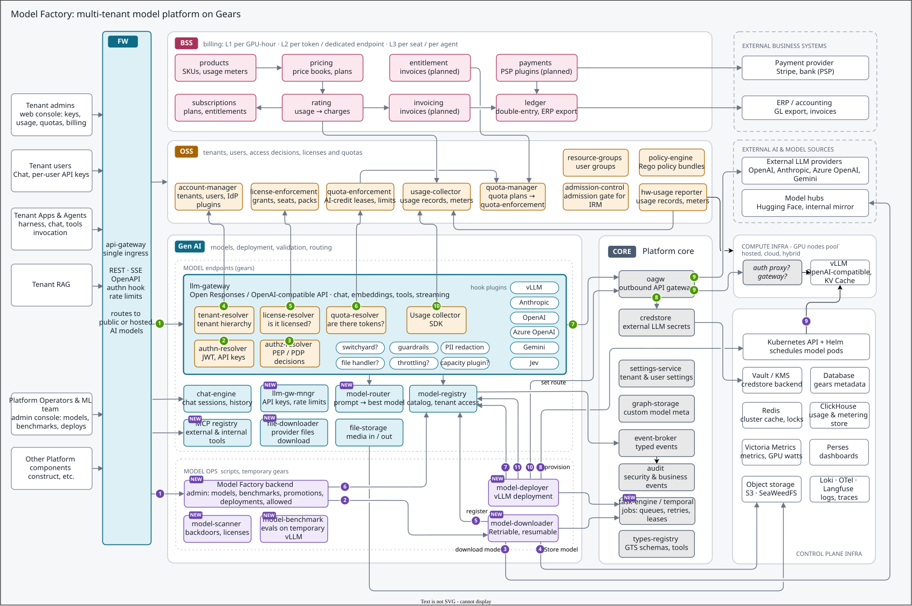

# DESIGN

## Architecture

## Open questions

1. who owns model deployment & status? Model deployer or model-registry?
2. Model names aliases (e.g. any GLM) - if GLM disappears, need to route GLM traffic somewhere. E.g. model upgrades
3. should vLLM have authetication on front?
4. Should we have file downloader? or better introduce proxy for files access + files registry?