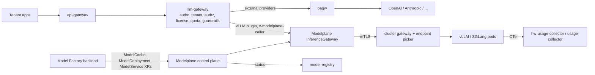

# Model Factory vs Modelplane: capabilities comparison

This document compares Model Factory (this repo: [diagram](img/model-factory.drawio.svg), [DECOMPOSITION](DECOMPOSITION.md), [DESIGN](DESIGN.md), built on `gears-rust`) with [Modelplane](https://github.com/modelplaneai/modelplane) (`.modelplane`, revision `9b6d0362`). It answers open question 13 in [DESIGN](DESIGN.md) ("Review https://modelplane.ai/").

Sources: Modelplane `README.md`, `design/*.md`, `docs/content/**`, `apis/*`, `functions/*`; `gears-rust` `gears/**` docs and code.

## 1. Summary

The two projects solve different layers of the same stack and overlap only in the middle.

- **Model Factory** is a multi-tenant, commercial model platform. Its value is in the layers above the GPU: tenants, licenses, quotas, AI credits, billing, a governed model catalog, a rich LLM API (Open Responses, tools, reasoning, structured output), external providers and Model Ops (scan, benchmark, approve, promote). The serving layer (deploy vLLM on Kubernetes) is one box in the diagram and mostly `TBD (new)`.
- **Modelplane** is a single-organization, fleet-level inference control plane on Crossplane. Its value is in the layers below the API: provisioning GPU clusters on six clouds, scheduling model replicas onto compatible GPUs across clusters, multi-node and disaggregated serving, weight caching, a fleet AI gateway with failover and canaries, and normalized telemetry. It explicitly leaves tenancy, rate cards, quotas and billing to "the system above it".

Modelplane is close to a drop-in for the bottom-right of the Model Factory diagram (model-deployer, part of model-downloader, the vLLM / Kubernetes + Helm / GPU pool boxes, the "auth proxy? gateway?" box, hw-usage-collector inputs, Prometheus/OTel for inference). It replaces nothing in BSS, OSS, llm-gateway semantics, model-registry governance or Model Ops quality gates.

## 2. Positioning

| Aspect | Model Factory (token-factory) | Modelplane |
|---|---|---|
| Problem | Sell and govern model access for many tenants (internal, partners, customers) | Run any model on any engine on a fleet of GPU clusters one organization owns |
| Primary users | Tenant admins, tenant users, tenant apps and agents, platform operators / ML team, other platform components | Platform team (clusters, hardware classes, gateways) and ML teams (deployments, services) |
| Tenancy | Hierarchical tenants, resource groups, per-tenant catalog, quotas, licenses, billing | None. Kubernetes namespaces only; caller identity is a flat string |
| Commercial model | AI credits, SKUs (GPU-hour, per token, dedicated endpoint, per seat), invoicing, ledger | "No usage caps or token metering" (FAQ). Cost attribution is a future telemetry consumer |
| Scope of "model" | External SaaS models and self-hosted models under one catalog | Self-hosted engines; external SaaS only as a backend `ModelEndpoint` |
| API style | Gear REST APIs (OpenAPI), SDK crates, GTS types, admin console | Kubernetes Resource Model: 19 XRDs (`modelplane.ai/v1alpha1`), `kubectl`, GitOps |
| Tech stack | Rust gears (ToolKit), Postgres, Redis, ClickHouse, Vault, event-broker, task-engine | Crossplane v2.3+ (Go core), Python composition functions, Envoy AI Gateway, Gateway API Inference Extension, llm-d endpoint picker, LWS / Grove / KAI, OTel collector |
| Runtime footprint | Gears deployed as services next to the rest of the platform | A control cluster (no GPUs) plus N inference clusters that Modelplane owns exclusively |
| Maturity | Design stage for Model Factory. Platform gears exist; llm-gateway and model-registry are SDK-only; task-engine and IRM are docs-only; Model Ops gears are new | Pre-1.0, implemented and e2e-tested. 20 functions, 11 validated recipes, breaking changes expected, no migrations promised |
| License / governance | Platform internal + open `gears-rust` | Apache 2.0, Upbound-led, planned donation to a foundation |

## 3. Layer mapping

How each box in the Model Factory diagram maps to Modelplane.

| Model Factory layer / box | Modelplane equivalent | Fit |
|---|---|---|
| FW / api-gateway (single ingress, auth hook, rate limits) | `InferenceGateway` (Envoy AI Gateway) for inference only | Partial. No tenant auth, no rate limits, no general REST |
| BSS (products, pricing, rating, subscriptions, entitlement, invoicing, payments, ledger) | None | Out of scope by design |
| OSS: account-manager, resource-groups | None (namespaces, Secrets) | Out of scope |
| OSS: license-enforcement / license-resolver | None | Out of scope |
| OSS: quota-manager / quota-enforcement / quota-enforcer-sdk | None. 429 from a backend is retried, not enforced | Out of scope (`fleet-gateway.md` non-goal) |
| OSS: usage-collector / usage SDK | Gateway usage record per request (structured access log: caller, service, endpoint, served model, input/output tokens, status) | Source only. No store, no aggregation, no AI credits |
| OSS: hw-usage-collector | OTel collector per cluster, DCGM / AMD exporters, `modelplane_gpu_*` with deployment/replica labels | Good source. GPU-hours and cost are left to the backend |
| OSS: policy-engine / admission-control | Fleet scheduler fit check (cluster labels + DRA CEL device match + free GPUs), taints | Technical admission only. No policy, no approvals |
| Gen AI: llm-gateway (Open Responses, plugins, pipeline hooks) | Fleet gateway: OpenAI `/v1` and Anthropic `/anthropic/v1`, model rewrite, credential injection, Anthropic -> OpenAI translation, priority failover, weighted split | Overlaps on routing only. No Open Responses, no normalization, no hooks, no cost |
| Gen AI: tenant / authn / authz / license / quota resolvers | `auth.method: APIKey` from labelled Secrets, or trust `x-modelplane-caller` from a fronting gateway | Minimal. Designed to sit behind a smarter gateway |
| Gen AI: guardrails, PII redaction | None | Gap |
| Gen AI: llm-gw-mngr (API keys, BYOK) | Caller keys as Secrets; backend keys as Secrets per `ModelEndpoint` | Minimal |
| Gen AI: model-router (aliases, semantic routing) | `ModelService`: stable name over endpoints, priority tiers, weights, external fallback | Aliases and canary: yes. Semantic / capability / cost routing: no |
| Gen AI: model-registry (catalog, sharing, shadowing, approval, lifecycle, metadata) | No catalog (explicitly rejected, `design.md` "Model catalog"). `ModelDeployment` / `ModelService` status, `GET /v1/models` per gateway | Gap. Status source only |
| Gen AI: chat-engine, MCP registry, file-storage, file-downloader | None | Out of scope |
| Model Ops: Model Factory backend | None (GitOps on XRs) | Gap |
| Model Ops: model-downloader | `ModelCache`: stage weights once per cluster on RWX storage from Hugging Face, with `authSecret` | Partial. Per cluster, not a central mirror; no checksums or progress API |
| Model Ops: model-scanner | None | Gap |
| Model Ops: model-benchmark | None (recipes are manual validation) | Gap |
| Model Ops: model-deployer | `ModelDeployment` -> `ModelReplica` -> workload on a cluster, readiness, rollout, `ModelEndpoint` | Strong. Exceeds DECOMPOSITION p1/p2 |
| Core: oagw | Fleet gateway -> cluster gateway hop over mutual TLS | Different role. oagw stays for external providers |
| Core: credstore / Vault | Kubernetes Secrets on the control plane, propagated to clusters | Weaker. No tenant tree, no rotation grace |
| Core: task-engine / temporal | Crossplane reconcile loop | Different model. No jobs, no progress API |
| Core: event-broker, audit, settings, types-registry | Kubernetes events and conditions, XRD schemas | Different model |
| Infra: IRM, Kubernetes API + Helm | Crossplane providers (helm, kubernetes, gcp, aws, azure, nebius, vultr, civo), `InferenceCluster`, `ServingStack` | Strong for inference clusters |
| Infra: vLLM / GPU nodes pool | Any container engine (vLLM, SGLang, TensorRT-LLM, NIM, Dynamo); NVIDIA, AMD, CPU via DRA | Strong |
| Infra: Prometheus, Grafana, Loki / OTel / Langfuse | OTel pipeline with one egress, `TelemetryDestination` sinks (OTLP, Prometheus remote write); logs/traces planned | Strong for metrics. No dashboards, no Langfuse |
| Infra: Redis, ClickHouse, Postgres, object storage | None (Kubernetes etcd); RWX storage class for caches (EFS on EKS, etc.) | Not comparable |

## 4. Detailed capabilities

Legend. Model Factory status: **Code** (gear has working code in `gears-rust`), **Docs** (PRD/DESIGN only), **SDK** (SDK crate only), **New** (no gear), **Infra** (to set up). Priority is from [DECOMPOSITION](DECOMPOSITION.md). Modelplane status: **Done** (implemented and documented), **Designed** (accepted or draft design, partly built), **Planned** (roadmap or "future improvements"), **No** (absent), **Non-goal** (explicitly excluded).

### 4.1 Inference API and gateway

| Capability | Model Factory | Modelplane |
|---|---|---|
| OpenAI Chat Completions | p1 via llm-gateway (SDK) | Done |
| Open Responses API as the primary contract | p1 (ADR-0001) | No |
| Anthropic Messages API | p1 pass-through (open question 10) | Done; translated to OpenAI backends. Anthropic-only backends serve Anthropic callers only |
| Embeddings | p1 | No (not mentioned anywhere) |
| Image / audio / video generation, STT, TTS, realtime | p2-p3 | No |
| Tool calling, structured output, reasoning normalization | p1 | Pass-through only (engine flags) |
| Provider error and completion status normalization | p1 | No |
| SSE streaming | p1 (FW, oagw, llm-gateway) | Done; requests usage on streams |
| Async jobs and batch | p2 | No |
| Single model name across many backends (alias) | p1 (model-registry / router) | Done (`ModelService`, model = `<namespace>/<service>`) |
| Weighted canary / A/B | p2 | Done (`weight` within a priority tier) |
| Failover to another backend on 429 / 5xx / timeout | p2 | Done (`priority` tiers, retries until first byte, outlier ejection; 429 does not eject) |
| Fallback from self-hosted to SaaS (Together, Baseten) | Implicit (external providers via plugins) | Done (manual `ModelEndpoint` with `origin`, `api.schema`, `model`, `credential`) |
| Native provider plugins (OpenAI, Anthropic, Azure, Gemini) | p1-p2 | No. Any OpenAI- or Anthropic-compatible backend only |
| Capability / cost-based routing | p2 (model-registry) | No |
| Semantic routing (prompt -> best model) | p3 | No |
| KV-cache / queue-aware routing inside a cluster | No | Done (Gateway API Inference Extension endpoint picker per replica) |
| Prefill/decode routing | No | Done (user-authored picker + sidecar) |
| Data residency | Commented-out policy-engine item | Done (one `InferenceGateway` per region, `serviceSelector`, cluster labels stamped on endpoints) |
| Multiple ingress points / HA | FW (single ingress) | Done (gateway per cluster; GSLB left to operator) |
| Request timeouts (TTFT, total) | p2 | Done per `ModelService` (`timeouts.request`, stream idle timeout); no TTFT-specific timeout |
| Gateway overhead target | < 50 ms P99, 500-2000 rps (llm-gateway PRD) | Not stated; two Envoy hops |

### 4.2 Identity, access and governance

| Capability | Model Factory | Modelplane |
|---|---|---|
| Tenant hierarchy and per-request tenant resolution | Code (tenant-resolver) | No |
| API key validation (hashed, expiry, revocation, scopes) | p1 authn-resolver (Code, extension needed) | Partial: keys in labelled Secrets, identity = entry name, no expiry or scopes |
| Per-key allowed models | p1 (account-manager, commented out) | No. "Every key can list and call every one"; scope by gateway instead |
| JWT / IdP users | Code (authn-resolver, account-manager IdP plugins) | No |
| PEP / PDP per model (`model:use`, `model:register`) | Code (authz-resolver), p1 roles | No (Kubernetes RBAC on XRs for management only) |
| Licensing (seats, premium models) | Code (license-resolver), Docs (license-enforcement) | No |
| Quotas: AI credits reserve/commit, tokens, concurrency | Code (quota-enforcement), p1 new types | Non-goal |
| Rate limiting per tenant / user | p2 | Non-goal (only an Envoy throttle counter in telemetry) |
| Trust a fronting gateway's identity | n/a | Done (`x-modelplane-caller` when `auth` is unset) |
| Caller key never forwarded to the model | Implied (credstore key per destination) | Done |
| Guardrails, PII redaction | p2 | No |
| Approval of models before use | p1 (model-registry approval, Model Factory backend) | No |
| Audit of management changes | p1 (audit gear new) | Kubernetes audit log only |
| Prompt / response metadata recording | p2 | Planned (traces, usage log) |

### 4.3 Model catalog and Model Ops

| Capability | Model Factory | Modelplane |
|---|---|---|
| Tenant-aware model catalog (providers, sharing, shadowing, effective catalog) | p1 model-registry (SDK only) | Non-goal (catalog rejected in `design.md`) |
| Model lifecycle states (registered -> retired) | p1 | Partial: deployment/replica/endpoint conditions (`RollingOut`, ready counts) |
| Model card metadata, license, quantization, context window | p1 | No |
| Deprecation with replacement and response headers | p2 | No |
| Download from Hugging Face | p1 model-downloader (New) | Done (`ModelCache`, `source: HuggingFace`, revision pinning) |
| Private / gated repos | p2 (credstore token) | Done (`authSecret`, propagated per cluster) |
| NGC and other registries | No | Mentioned in FAQ (NIM artifacts); only HuggingFace is a `ModelCache` source today |
| Retriable, resumable downloads, checksums, progress | p1 | No (hydration job per cluster) |
| Central internal mirror reused across tenants | p2 | Per cluster only; ModelExpress peer-to-peer GPU weight transfer on Dynamo |
| Unsafe format / malware scan, license check | p1 model-scanner (New) | No |
| Performance benchmark on a temporary deployment | p1 model-benchmark (New) | No (manual recipes) |
| Quality evals (MMLU, GSM8K, tenant sets) | p2 | No (guide only) |
| GPU / vLLM settings recommendation | p2 | No. Recipes are copyable worked examples |
| Promotion staging -> production, alias switch | p2 | Manual: edit `ModelService` weights |
| Lifecycle pipeline as jobs with logs (download -> scan -> bench -> deploy) | p1 (task-engine Docs + backend New) | No. Declarative reconcile, no pipeline |
| Admin console | p1 | No UI (kubectl, docs site) |

### 4.4 Serving and deployment

| Capability | Model Factory | Modelplane |
|---|---|---|
| Deploy vLLM on Kubernetes | p1 model-deployer (New) via IRM / Helm | Done |
| Engine-agnostic (SGLang, TRT-LLM, NIM, custom) | vLLM only in diagram | Done. Modelplane never injects engine flags |
| GPU type / count selection | p1 (fixed parameters) | Done: DRA device requests with CEL selectors (memory, architecture, vendor) |
| Multiple accelerators (NVIDIA, AMD, CPU, TPU/Trainium planned) | No | Done for NVIDIA / AMD / CPU; others via BYO |
| Single-node tensor parallel | Implied | Done |
| Multi-node (TP + PP, DP + EP) gangs | No | Done (LeaderWorkerSet on Standard, Grove `PodCliqueSet` on Dynamo) |
| Disaggregated prefill / decode | No | Done (`serving.mode: PrefillDecode`) |
| Topology-aware, all-or-nothing gang scheduling | No | Done on Dynamo stack (Grove + KAI) |
| Multi-cluster scheduling | No (single GPU pool in diagram) | Done (cluster labels -> pool -> free GPUs, re-place on cluster loss) |
| Free-GPU accounting | p1 IRM capacity report (Docs) | Done (cluster agent reports free devices per pool) |
| Health checks and status in registry | p1 | Done for status. Registry sync is yours |
| Rolling updates without downtime | p2 | Done (`RollingOut`, replaces copies) |
| Autoscaling | p2 (queue length, GPU usage) | Done via scale subresource: `kubectl scale`, KEDA `ScaledObject`. No built-in policy |
| Scale to zero | p2 | No (replicas only; KEDA could drive it, cold start not addressed) |
| Dedicated vs shared endpoints per tenant | p2 | Expressible (separate deployment + service + gateway), no tenant concept |
| Cluster drain / maintenance | No | Done (`InferenceCluster.spec.taints` `NoSchedule` / `NoExecute`) |
| Disable model code execution (`trust_remote_code`) | p1 | Not enforced (engine flags are user-owned) |
| KV cache / prefix caching settings | p2 | Engine flags; routing uses prefix-cache locality |
| Speculative decoding | No | Recipe exists (`qwen3-8b-speculative-decoding`) |

### 4.5 Infrastructure

| Capability | Model Factory | Modelplane |
|---|---|---|
| Provision Kubernetes clusters | Not in scope (IRM adapters, Docs) | Done: GKE, EKS, AKS, Nebius, Vultr, Civo; BYO any K8s |
| GPU node pools from hardware recipes | Infra (manual) | Done (`InferenceClass`) |
| Capacity reservations (GKE, EKS Capacity Blocks) | No | Done (`CapacityReservation`) |
| Serving stack install (GPU operator, DRA driver, gateway, cert-manager, LWS, Prometheus) | Infra p1 | Done, generated per cloud from NVIDIA AICR + Modelplane overlays |
| Hosted / cloud / hybrid GPU pools | p2 | Done (fleet of clusters across clouds and on-prem BYO) |
| On-prem / air-gapped | Implied (Virtuozzo IRM, internal mirror) | BYO only. No registry override: charts and images pull from upstream |
| Per-cluster version pinning / overrides | n/a | Non-goal: stack upgrades ride Modelplane releases, fleet-wide |
| Requirements | Platform DBs + Kubernetes | Crossplane 2.3+, Kubernetes 1.35+ with DRA, exclusive ownership of each inference cluster, RWX storage for caches |

### 4.6 Observability and metering

| Capability | Model Factory | Modelplane |
|---|---|---|
| Per-model request metrics (requests, errors, latency, TTFT, TPS) | p1 llm-gateway Prometheus | Done: `modelplane_frontend_*` (gateway), engine series |
| Normalized metrics across engines | No | Done (one `modelplane_*` namespace, vLLM vs SGLang differences handled) |
| GPU metrics (usage, memory, power) | p1 Prometheus | Done (DCGM / AMD exporter, labelled by deployment and replica except GKE) |
| GPU-hours per tenant and deployment (usage records) | p1 usage-collector | Raw series only; "cost attribution to a tenant" is a future consumer |
| Token usage per caller | p1 usage-collector (AI credits) | Done as access-log record; failed requests logged without tokens |
| Fleet-wide export | Loki / OTel / Langfuse infra p1 | Done (`TelemetryDestination`: OTLP, Prometheus remote write; egress-only) |
| Distributed traces from ingress to vLLM | p1 | Planned (#77) |
| Dashboards and alerts | p1-p2 | No (operator's backend) |
| Langfuse / prompt analytics | p2 | No |

## 5. What Modelplane answers in DESIGN open questions

| # | Question | What Modelplane does | Takeaway for Model Factory |
|---|---|---|---|
| 1 | Who owns deployment and status? | `ModelDeployment` owns replicas; a `ModelEndpoint` exists only while its replica serves; `ModelService` reads endpoints by label | model-deployer owns deployment status. model-registry should consume it (event) and own only the catalog view |
| 2 | Model aliases when a model disappears | `ModelService` is the stable name; endpoints behind it change; priority tiers fail over to another deployment or a SaaS endpoint | Keep aliases as a routing object separate from model identity. Move the alias item out of the model-registry section or make it explicit that model-registry owns aliases |
| 3 | Auth in front of vLLM | No auth proxy. The cluster gateway requires mutual TLS from the fleet gateway; per-cluster PKI via cert-manager and trust-manager; fails closed; private keys never leave a cluster | Prefer mTLS between oagw (or the fleet gateway) and the cluster edge over per-endpoint API keys |
| 5 | Issue / revoke / authenticate LLM Gateway clients | Flat Secrets; recommended mode is to trust identity from a fronting gateway | Keep this in authn-resolver / llm-gw-mngr; Modelplane cannot serve tenant keys |
| 6 | Inbound vs outbound rate limits | Neither. Backend 429s are retried and do not count towards ejection | Inbound: quota-enforcement. Outbound: oagw. Treat backend 429 as "try another endpoint", not as failure |
| 7 | Outbox vs sync usage | Async: structured access log per request, usage requested on streams, record written even on failure | Use async (outbox) and always write a record, with tokens only when the backend answered |
| 8 | hw-usage-collector and GPU usage | DCGM exporter scraped by an OTel collector, labelled with deployment/replica; GPU-hours computed by the backend | hw-usage-collector can read these series and turn them into usage records per tenant via a deployment -> tenant map |
| 13 | Review modelplane.ai | This document | |

## 6. Gaps in DECOMPOSITION that Modelplane exposes

These are capabilities Modelplane has that the current DECOMPOSITION does not mention. Decide whether each is in scope.

- Multi-node serving (models larger than one node: TP + PP, DP + EP) and gang scheduling.
- Disaggregated prefill / decode and KV-cache-aware routing inside a cluster.
- More than one GPU cluster: placement by region / provider / compliance labels, re-placement on cluster loss, cluster drain.
- Engines other than vLLM (SGLang, TensorRT-LLM, NIM) and accelerators other than NVIDIA.
- Weight cache per cluster on shared storage to cut cold starts, and peer-to-peer weight transfer.
- GPU capacity reservations.
- Regional ingress for data residency.
- Encryption and mutual authentication on the gateway -> GPU cluster hop.
- Telemetry normalized across engines, with GPU series joined to deployments.

## 7. Integration options

### Option A: Modelplane as the serving layer under Model Factory

Model Factory keeps everything above the endpoint. Modelplane owns clusters, placement and serving.

- model-deployer becomes a thin adapter that writes `ModelCache`, `ModelDeployment` and `ModelService` objects and maps their conditions to model-registry status. It could also be an IRM adapter.
- model-downloader for self-hosted models reduces to `ModelCache`; a central mirror can still sit in object storage.
- llm-gateway's vLLM plugin targets one `InferenceGateway` URL with `model: <namespace>/<service>` and sets `x-modelplane-caller` to the tenant or API key id. The gateway runs without `auth` and must be reachable only from llm-gateway / oagw.
- model-benchmark creates a temporary `ModelDeployment` and deletes it afterwards.
- hw-usage-collector and Prometheus read the Modelplane telemetry stream through a `TelemetryDestination`.

Saves: model-deployer internals, the IRM Kubernetes adapter for GPU workloads, the vLLM Helm chart, the GPU node pool setup, GPU scheduling, autoscaling plumbing, rolling updates, vLLM auth, GPU telemetry wiring.

Costs and risks:

- Crossplane and Python functions join a Rust platform; operators need both skill sets.
- Pre-1.0 with breaking API changes and no migrations.
- Each inference cluster is owned exclusively by Modelplane and needs Kubernetes 1.35+ with DRA.
- Serving stack versions ride Modelplane releases fleet-wide, with no overrides and no private registry mirror. This is a blocker for air-gapped or on-prem Virtuozzo deployments unless fixed upstream or worked around with the break-glass `Composition`.
- Extra hops: llm-gateway -> InferenceGateway -> cluster gateway -> picker -> pod. Measure against the < 50 ms P99 overhead target.
- Two routing layers can disagree (model-router aliases vs `ModelService` priorities). Pick one owner for fallback across self-hosted deployments.
- Tenant-dedicated endpoints become one `ModelDeployment` + `ModelService` per tenant, with tenant isolation enforced only by llm-gateway.

### Option B: reuse ideas, build in gears

Keep the planned gears and borrow the design decisions:

- `ModelDeployment -> ModelReplica -> ModelEndpoint -> ModelService` as the resource model for model-deployer and model-router.
- Engine-agnostic deployments: store the engine container and args, never derive flags.
- Priority tiers + weights for fallback and canary; 429 retried but not ejected; retry only until the first byte.
- Endpoint registered only once the replica is ready.
- mTLS from the gateway to the GPU cluster edge.
- Usage record on every request, including failures.
- Normalized `*_ttft_seconds`, `*_tpot_seconds` metric names across engines.

### Option C: no relation

Model Factory stays single-cluster vLLM through IRM. Reasonable only if multi-cluster, multi-node and non-vLLM engines stay out of scope.

## 8. Review notes on the current artifacts

Found while reading the diagram and DECOMPOSITION for this comparison.

- DECOMPOSITION uses `model-gateway` in many items; the diagram and the gear are `llm-gateway`.
- The FW section is titled `Nginx` with owner "Envoy gateway API"; the diagram box is `api-gateway`.
- The first item under `model-registry` creates "the model-router gear with model aliases". It belongs to `model-router`, or the model-router section should say aliases live in model-registry.
- The priority legend defines `p1`-`p3`, but items use `p4` and `p5`.
- The diagram shows `quota-resolver`; DECOMPOSITION calls it `quota-enforcer-sdk` (open question 14).
- IRM has a DECOMPOSITION section and appears in the admission-control box text, but the diagram has no IRM box; model-deployer arrows go straight to Kubernetes API + Helm.
- `resource-groups` has no items (`???`); `hw-usage-collector`, `policy-engine`, `admission-control` and `account-manager` items are commented out.
- `PRD.md` is empty.
